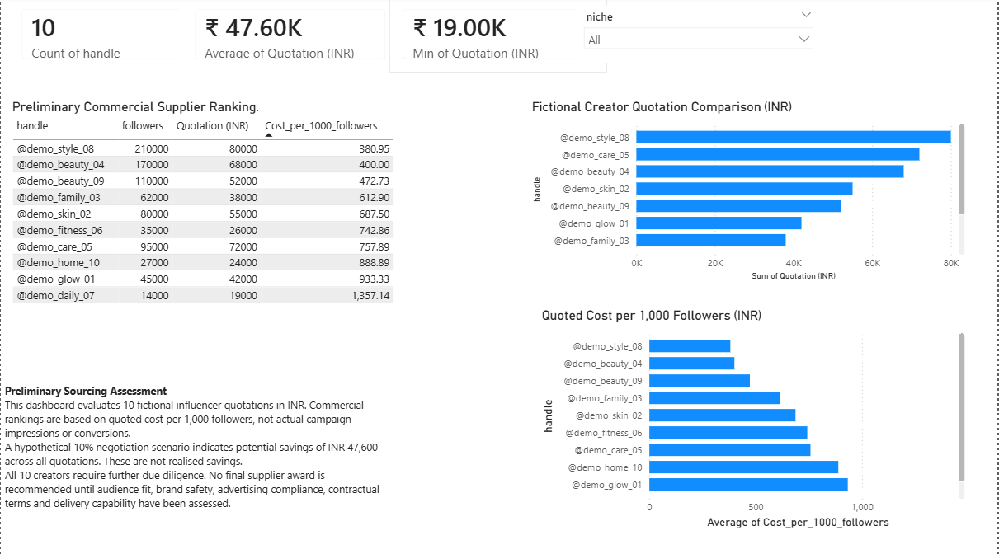
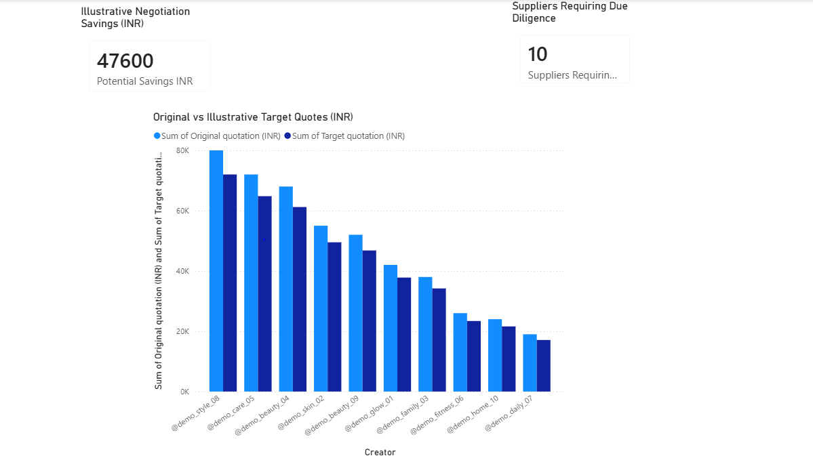
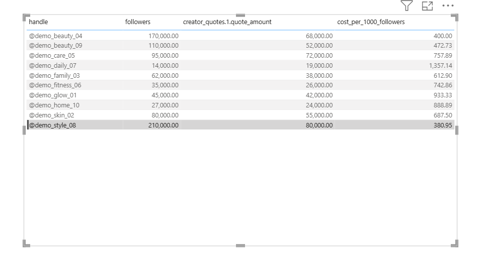

# Influencer Sourcing & Procurement Analytics

**A procurement analytics portfolio project using SQLite, WPS Spreadsheets and Power BI Desktop.**

## Project Overview

This project demonstrates a structured approach to influencer supplier sourcing, quotation analysis, preliminary supplier evaluation, negotiation scenario modelling and quotation change tracking.

It was developed as an independent learning project to demonstrate practical skills relevant to junior procurement, purchasing and influencer-sourcing roles.

The portfolio combines SQL analysis, spreadsheet modelling and Power BI reporting to support data-informed commercial decisions.

## Business Objectives

- Compare fictional creator quotations and identify cost-efficiency differences.
- Build a preliminary supplier evaluation and risk-assessment framework.
- Model hypothetical negotiation savings.
- Present procurement insights through Power BI dashboards.
- Demonstrate SQL-based quotation change detection, audit logging and manual Power BI refresh.
- Document data limitations and procurement due-diligence requirements.

## Tools Used

| Tool | Purpose |
|---|---|
| SQLite and DB Browser for SQLite | Data storage, SQL analysis, joins and quotation change tracking |
| WPS Spreadsheets | Quotation calculations, commercial charts, supplier scorecards, risk assessment and negotiation analysis |
| Power BI Desktop | Commercial reporting, procurement decision support and SQLite-connected analysis |
| Windows ODBC | Local connection between SQLite and Power BI |
| Power Query | Data transformation, merging and calculated columns |
| GitHub | Project documentation, reproducible SQL scripts and portfolio presentation |

## Portfolio Files

### SQL Analysis

- [Fictional SQLite Demo](01_SQL/Demo_Data/README.md)
- [SQLite Database Setup Script](01_SQL/Demo_Data/01_setup_demo_database.sql)
- [SQL Verification Script](01_SQL/Demo_Data/02_verify_demo_data.sql)
- [Fictional Creator Profiles CSV](01_SQL/Demo_Data/fictional_creator_profiles.csv)
- [Fictional Creator Quotations CSV](01_SQL/Demo_Data/fictional_creator_quotes.csv)
- [Quotation Change Tracking](01_SQL/Batch_Change_Tracking/README.md)

### Spreadsheet Analysis

- [Download WPS Analysis Workbook](02_WPS_Analysis/Influencer_Sourcing_Portfolio_Public.xlsx)

The workbook includes fictional creator quotation analysis, commercial charts, preliminary supplier scorecards, risk and due-diligence tracking, hypothetical negotiation scenarios and a sourcing summary.

### Power BI Reporting

- [Download Power BI Portfolio](03_Power_BI/Influencer_Sourcing_Portfolio_Public.pbix)

The Power BI report contains three pages:

1. Commercial Analysis
2. Procurement Decision
3. Automation Test

The report was developed using local spreadsheet and SQLite/ODBC connections. Refreshing the downloaded Power BI file on another computer may require reconfiguring those connections.

## Dataset Transparency

The commercial analysis uses **10 fictional creator profiles and fictional quotations denominated in Indian rupees (INR)**.

Creator handles, quotation amounts and associated demonstration metrics are synthetic. They should not be interpreted as verified supplier information or actual market quotations.

A separate public Indian creator dataset was used for benchmarking exercises during development. It is heavily concentrated in the macro-creator tier and is not representative of UK influencer pricing or the full range of creator tiers.

**The public benchmark dataset is not included in this repository because its redistribution permissions have not been verified.**

All negotiation savings are hypothetical. Supplier compliance and due-diligence checks have not been completed.

This is an independent training project and is not affiliated with, endorsed by or based on confidential data from P&G.

## Power BI Portfolio

### 1. Commercial Analysis

This page presents fictional quotation comparisons, commercial metrics and cost-efficiency analysis.

### 2. Procurement Decision

This page supports preliminary supplier comparison and highlights the need for additional supplier evidence and due diligence.

### 3. Automation Test

This page demonstrates a SQLite-connected Power BI analysis that was updated through manual data refresh.

## Project Workflow

### 1. SQL Analysis

Used DB Browser for SQLite to practise:

- Filtering and grouping creator data
- Joining creator profiles with quotations
- Calculating quotation statistics
- Ranking fictional creators by cost efficiency
- Checking data quality
- Comparing incoming quotation batches

A standalone fictional SQLite dataset can be recreated using the setup script in `01_SQL/Demo_Data`.

### 2. WPS Spreadsheet Analysis

Developed an influencer-sourcing workbook containing:

- Creator and quotation analysis
- Commercial charts
- Preliminary supplier scorecard
- Supplier risk and due-diligence tracking
- Hypothetical negotiation analysis
- Sourcing summary

Unverified supplier-assessment fields remain unscored. The scorecard is a preliminary analytical framework, not a supplier approval decision.

### 3. Power BI Reporting

Created a three-page portfolio report.

The Commercial Analysis and Procurement Decision pages were developed using spreadsheet data.

The Automation Test page uses SQLite data through an ODBC connection and Power Query.

Power Query merges fictional creator profiles with quotation records using `creator_id` and calculates cost per 1,000 followers.

### 4. Quotation Change Tracking

Demonstrated a manual SQL workflow to:

- Preserve an original quotation snapshot
- Compare an incoming quotation batch
- Identify changed records
- Log changes in an audit table
- Update quotation records using a transaction
- Refresh Power BI to observe the updated data

The original fictional quotations were restored after testing.

The audit log covers the demonstration batch, but the subsequent restoration was not separately audited.

See the [Batch Change Tracking documentation](01_SQL/Batch_Change_Tracking/README.md).

## Key Commercial Findings

The fictional dataset contains 10 creator quotations denominated in INR.

| Metric | Result |
|---|---:|
| Fictional creator quotations | 10 |
| Total quotation value | INR 476,000 |
| Average quotation | INR 47,600 |
| Median quotation | INR 47,000 |
| Lowest quotation | INR 19,000 |
| Highest quotation | INR 80,000 |
| Hypothetical savings at 10% | INR 47,600 |
| Hypothetical total after 10% savings | INR 428,400 |

### Cost-Efficiency Analysis

Cost per 1,000 followers was calculated as:

**Quotation amount ÷ Follower count × 1,000**

This is a simple quotation-to-audience-size ratio.

It is not advertising CPM, cost per impression, verified reach or engagement performance.

### Procurement Interpretation

Quotation comparisons can support initial supplier shortlisting, but final selection also requires:

- Audience suitability and brand fit
- Verified performance evidence
- Commercial terms and deliverables
- Supplier compliance and due diligence
- Relevant approval controls

The 10% negotiation scenario is illustrative. No actual savings were negotiated or realised.

## SQL Reproducibility

The fictional dataset was successfully recreated in a new, empty SQLite database.

The setup script created:

- 10 fictional creator profiles
- 10 fictional quotation records

The verification queries confirmed:

- Total quotation value: INR 476,000
- Average quotation: INR 47,600
- Minimum quotation: INR 19,000
- Maximum quotation: INR 80,000

The creator-profile and quotation tables were successfully joined using `creator_id`.

### How to Reproduce the Demo

1. Install DB Browser for SQLite.
2. Create a new, empty SQLite database.
3. Run [01_setup_demo_database.sql](01_SQL/Demo_Data/01_setup_demo_database.sql).
4. Run [02_verify_demo_data.sql](01_SQL/Demo_Data/02_verify_demo_data.sql).
5. Compare the results with the expected figures above.

The setup script contains the fictional records directly, so importing the CSV files is not required.

The demonstration scripts are intended for a fresh database, not for execution against an existing production database.

## Power BI Refresh and Reproducibility

The final portfolio report contains three pages:

- **Commercial Analysis:** developed using WPS spreadsheet data.
- **Procurement Decision:** developed using WPS spreadsheet data.
- **Automation Test:** uses SQLite data through an ODBC connection.

The SQLite connection was configured locally using a Windows 64-bit ODBC DSN named `Influencer_SQLite`.

During testing, SQLite quotation values were updated, Power BI was refreshed manually, and the new values appeared in the Automation Test table.

The original quotations were subsequently restored.

The Power Query transformations are repeatable on refresh, but the project does not implement unattended scheduled data ingestion or automatic refresh.

To reproduce the SQLite-connected report on another computer, the required SQLite tables, suitable ODBC driver and local connection configuration must be recreated.

The quotation CSV alone is not sufficient to reproduce the full Power BI connection.

## Project Limitations

- Commercial creator profiles and quotations are fictional.
- Quotation amounts are in INR, not GBP.
- The public Indian creator benchmark is separate from the fictional quotation analysis.
- The public benchmark is heavily concentrated in the macro-creator tier and is not a representative UK pricing benchmark.
- Supplier due diligence has not been completed.
- Weighted supplier assessments require evidence before meaningful scores can be assigned.
- Negotiation savings are hypothetical.
- Power BI refresh was performed manually.
- The audit log covers the demonstration batch, not every subsequent restoration action.
- The report uses different source connections across its pages.
- The downloadable Power BI report may require local connection changes before refresh.

## Future Improvements

- Add verified supplier engagement and audience data.
- Incorporate UK-specific commercial benchmarks where licensing permits.
- Complete documented supplier due diligence.
- Add automated data validation and exception reporting.
- Introduce scheduled refresh where supported.
- Extend audit logging to include every quotation change.
- Add approval controls for supplier and quotation updates.
- Build a more integrated reporting data model.

## Responsible Data Use

This portfolio is an independent learning project.

It does not contain actual P&G supplier quotations, confidential procurement information or verified supplier compliance approvals.

The publicly shared demonstration data is synthetic. The original public benchmark dataset is excluded pending verification of redistribution permissions.
